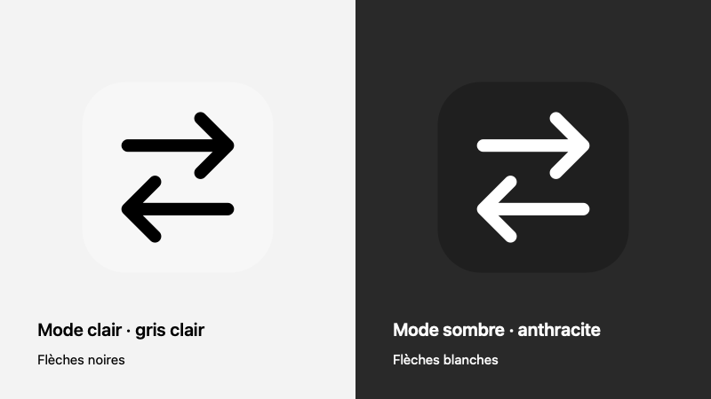

# Selected monochrome logos



- Light: light-gray rounded tile (`#F7F7F7`), black arrows.
- Dark: charcoal rounded tile (approximately `#1F1F1F`), white arrows. About uses the native system application image; these raw variants remain a fallback when that image is unavailable. Finder/Spotlight have native light/dark variants compiled from `Resources/AppIcon.icon`.
- Menu bar: the same arrows without the tile, rendered as an 18-point template image so macOS supplies the tint. Unavailable and paused status indicators keep their existing behavior.

The original arrow paths and tile geometry are preserved. Both tiles match ScreenshotOCR’s neutral backgrounds (0.97 light / 0.12 dark) and retain a transparent exterior. The blue artwork in earlier proposal folders is historical.

The shared source is `scripts/make-icon.swift`. `light/` and `dark/` contain transparent PNGs at 88, 176, 512 and 1024 pixels. The build script packages `ClearCommandTab.icns`, `ClearCommandTab-dark.icns` and `ClearCommandTab-menu.png` before signing. It also compiles `AppIcon.icon` into `Assets.car` using Xcode's macOS `actool`. Its alpha mask is generated from the same `drawArrows` paths, with matching neutral backgrounds and black/white arrow specializations and no glass/specular effects. Selected PNGs and About ICNS files use the same backgrounds; the arrow mask and menu template are unchanged. This pipeline handles only ClearCommandTab's own logo.

```sh
swift scripts/make-icon.swift --selected-assets Design/SelectedLogo
swift scripts/make-icon.swift /tmp/ClearCommandTab.icns
swift scripts/make-icon.swift --dark /tmp/ClearCommandTab-dark.icns
swift scripts/make-icon.swift --menu /tmp/ClearCommandTab-menu.png
swift scripts/make-icon.swift --native-glyph /tmp/ClearCommandTab-arrows.png
zsh scripts/check-icon-catalog.sh
```
